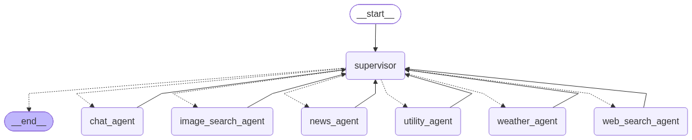

<div align="center">
  
  <h1>Aether AI</h1>
  <p>A multi-agent assistant for conversation, research, documents, and everyday tools.</p>
  <p>
    <a href="#live-demo"></a>
    <a href="#backend-api"></a>
  </p>
</div>

> **Deployment status:** The public frontend and Hugging Face Space URLs have not been provided yet. The buttons above currently point to the relevant setup sections; replace their links with the deployment URLs when they are available.

## Contents

- [Overview](#overview)
- [What Aether AI can do](#what-aether-ai-can-do)
- [How the agent workflow works](#how-the-agent-workflow-works)
- [Technology stack](#technology-stack)
- [Project structure](#project-structure)
- [Run locally](#run-locally)
- [Configuration and API keys](#configuration-and-api-keys)
- [API overview](#api-overview)
- [Deploy the backend to Hugging Face Spaces](#backend-api)
- [Connect a deployed frontend](#live-demo)
- [Privacy and deployment notes](#privacy-and-deployment-notes)
- [About the builder](#about-the-builder)

## Overview

Aether AI is a web-based assistant backed by a routed, multi-agent workflow. A React frontend sends chat requests to a FastAPI service. Laya classifies the request's complexity and selects a model; a LangGraph supervisor then responds directly or delegates work to a specialist agent and its tools.

The application also includes PDF question answering through a Pinecone-backed retrieval pipeline, browser-based speech input, and read-aloud responses.

## What Aether AI can do

- Answer general questions and help with writing and brainstorming.
- Search the web and discover images.
- Find recent news and weather information.
- Perform calculations, unit conversions, and date/time lookups.
- Upload PDFs and ask questions grounded in their contents.
- Dictate messages, optionally translate non-English speech to English, and review transcripts before sending.
- Read assistant responses aloud.
- Stream agent and tool activity alongside the response.

Tool availability depends on its external service and configuration. For example, Tavily, Unsplash, news, Groq, and Pinecone integrations require their corresponding credentials.

## How the agent workflow works

The diagram below is the project's workflow illustration. The current implementation also includes a knowledge-base agent for PDF retrieval; that agent was added after this diagram was created.



### Request lifecycle

1. **The frontend submits a message** to `POST /api/chat/stream` and reads the response as Server-Sent Events (SSE).
2. **Laya routes by complexity.** Its task-complexity classification chooses the configured simple or complex model.
3. **The supervisor analyzes the request** and chooses a specialist, or handles coordination among multiple relevant specialists.
4. **A specialist calls focused tools** when needed. For document questions, the knowledge-base specialist retrieves relevant PDF chunks.
5. **The backend streams progress and answer events** to the browser. The UI can show routing, supervisor status, agent activity, and tool activity while tokens arrive.

### Specialist agents

| Agent | Responsibilities | Example tools or integrations |
|---|---|---|
| `chat_agent` | General conversation, explanations, writing, and brainstorming | No external tools |
| `web_search_agent` | Web research and page inspection | Tavily, DuckDuckGo, Wikipedia search, webpage fetch |
| `image_search_agent` | Find relevant image results and source details | Unsplash, DuckDuckGo image search |
| `news_agent` | Recent news and headlines | News API and headline source |
| `weather_agent` | Current conditions and forecasts | Weather service tools |
| `utility_agent` | Arithmetic, unit conversions, and current date/time | Calculator and utility tools |
| `knowledge_base_agent` | Answer questions using uploaded PDFs | Pinecone-backed retrieval |

## Technology stack

- **Frontend:** React 18, Vite, JavaScript, and CSS.
- **API:** Python 3.11+, FastAPI, and Uvicorn.
- **Routing and orchestration:** Laya, LangChain, and LangGraph supervisor/agent graphs.
- **Language models:** Groq, XKIRO (OpenAI-compatible), and Google Gemini; Laya selects a simple or complex pool, then one model is chosen randomly from that pool.
- **PDF retrieval:** PyMuPDF/PyPDF, Hugging Face sentence-transformer embeddings and reranking, and Pinecone vector storage.
- **Speech:** Faster-Whisper for speech-to-text and Edge TTS for read-aloud audio.
- **Deployment:** Docker; the backend Dockerfile is configured for Hugging Face Spaces on port `7860`.

## Project structure

```text
.
├── agents_workflow/       # Supervisor prompt and specialist-agent definitions
├── backend/
│   ├── rag_routers/       # PDF knowledge-base API
│   ├── stt_service/       # Speech-to-text API
│   └── tts_service/       # Text-to-speech API
├── frontend/              # React + Vite application
├── laya/                  # Request-complexity routing
├── rag/                   # PDF ingestion and retrieval pipeline
├── agent_workflow.png     # Agent workflow diagram
├── app.py                 # FastAPI application and chat SSE endpoint
├── Dockerfile             # Backend container image
├── .dockerignore          # Docker build-context exclusions
└── requirements.txt       # Python dependencies
```

## Run locally

### Prerequisites

- Python 3.11 or newer.
- Node.js 18 or newer and npm.
- FFmpeg for audio decoding.
- A Pinecone account and the API keys required for the integrations you want to use.

### 1. Configure the backend

From the project root, create a virtual environment and install the Python dependencies:

```bash
python -m venv .venv
```

Activate it, then run:

```bash
python -m pip install --upgrade pip
python -m pip install -r requirements.txt
```

Create a root `.env` file and add the credentials described in [Configuration and API keys](#configuration-and-api-keys). Do not commit this file.

Start the API from the project root:

```bash
uvicorn app:app --reload --host 0.0.0.0 --port 8000
```

The API root is `http://127.0.0.1:8000`; interactive API documentation is at `http://127.0.0.1:8000/docs`.

### 2. Configure and start the frontend

In a second terminal:

```bash
cd frontend
npm install
```

Copy `.env.example` to `.env` in the `frontend/` directory if you need to change the API URL. It points to the hosted backend at `https://junaid17-synapseai.hf.space`; for a local backend, change it to `http://127.0.0.1:8000`.

Start the development server:

```bash
npm run dev
```

Open `http://localhost:5173`.

To create and preview a production frontend build:

```bash
npm run build
npm run preview
```

## Configuration and API keys

Set backend credentials as environment variables in a local root `.env` file or in your hosting provider's secret manager. Never put secrets in frontend variables, source control, or a public README.

| Variable | Needed for | Notes |
|---|---|---|
| `GROQ_API_KEY` | Chat and agent responses | Required for Groq models. |
| `XKIRO_API_KEY` | Chat and agent responses | Required for XKIRO models. |
| `GOOGLE_API_KEY` | Chat and agent responses | Required for Gemini models. |
| `PINECONE_API_KEY` | PDF knowledge-base features | Required by the RAG pipeline. |
| `GROQ_MODEL` | Default graph initialization | Optional; code defaults to `openai/gpt-oss-20b`. Chat requests select randomly from the configured simple or complex model pool. |
| `TAVILY_API_KEY` | Tavily web search | Optional; DuckDuckGo search is also available. |
| `UNSPLASH_ACCESS_KEY` | Unsplash image search | Optional. |
| `NEWS_API_KEY` | News search | Optional. |

Other dependencies and tool providers may have their own environment configuration. Check the relevant provider documentation before deployment.

## API overview

| Method | Endpoint | Purpose |
|---|---|---|
| `GET` | `/` | API welcome/status response |
| `GET` | `/health` | Health check |
| `POST` | `/api/chat/stream` | Route and stream a chat response as SSE |
| `POST` | `/stt` | Transcribe uploaded audio; optional translation and language detection |
| `GET` | `/stt/supported_languages` | List speech-recognition language codes |
| `POST` | `/tts` | Generate read-aloud audio |
| `GET` | `/tts/available_voices` | List available voices |
| `GET` | `/api/knowledge-base/documents` | List documents for the supplied browser profile |
| `POST` | `/api/knowledge-base/upload` | Upload and index PDF documents |
| `GET` | `/api/knowledge-base/status` | Check knowledge-base service status |
| `POST` | `/api/knowledge-base/search` | Search indexed documents |
| `DELETE` | `/api/knowledge-base/documents/{document_id}` | Remove one document |
| `DELETE` | `/api/knowledge-base/documents` | Remove documents for the supplied browser profile |

The complete request and response schemas are available from FastAPI at `/docs` while the backend is running.

## Deploy the backend to Hugging Face Spaces

The root [Dockerfile](Dockerfile) and Space metadata at the top of this README configure a Docker Space listening on port `7860`.

1. Create a new Hugging Face Space and choose **Docker** as its SDK.
2. Upload or push this repository to the Space.
3. Add required credentials in **Settings → Variables and secrets**. Configure `GROQ_API_KEY`, `XKIRO_API_KEY`, and `GOOGLE_API_KEY` for random multi-provider chat; add `PINECONE_API_KEY` for PDF retrieval.
4. Wait for the Space image to build, then check `/health` or open `/docs` on the Space URL.
5. Update the backend CORS allowlist in `app.py` to include the exact origin of the deployed frontend before connecting a public frontend.

Do not commit `.env` files or API keys. `.dockerignore` excludes local environment files and development artifacts from the image build context.

### Backend API

**Hugging Face Space:** Not deployed yet. Once created, replace the `#backend-api` target in the Hugging Face badge near the top of this README with the Space URL, for example `https://huggingface.co/spaces/your-username/your-space`.

## Connect a deployed frontend

In Vercel, add `VITE_API_BASE_URL` under **Project Settings → Environment Variables** for each environment you deploy (Production, Preview, and/or Development). Set its value to the public base URL of your backend, with no trailing slash:

```text
VITE_API_BASE_URL=https://your-backend-url
```

For a local production build, put the same setting in `frontend/.env.production`. Vite embeds `VITE_` variables into the client bundle at build time, so this value is a public API URL, not a place for secrets. Redeploy the frontend after changing it. Also add the frontend's exact origin to the backend CORS allowlist in `app.py`.

### Live demo

**Live app:** Not deployed yet. Once hosted, replace the `#live-demo` target in the Live App badge near the top with the public frontend URL.

## Privacy and deployment notes

- **No authentication:** The app currently has no sign-in or server-verified user identity. Do not treat it as a secure multi-user service for private data.
- **PDF profile IDs are not an access-control boundary:** The frontend associates documents with a browser-generated profile ID. The backend accepts that ID from the request, so a client that can alter requests may impersonate another profile.
- **Chat history is local to the browser UI:** The backend's LangGraph `MemorySaver` is in-memory and is lost when the backend process restarts. There is no durable server-side chat-history store.
- **External services process requests:** Chat, search, embeddings, vector storage, speech recognition, and read-aloud features may send data to their configured providers. Review provider policies before uploading sensitive content.
- **Resource use:** Speech recognition and embedding/reranking models can take time and memory to download and initialize. Plan hosting resources for model size and expected traffic.
- **CORS must match production:** The current allowlist in `app.py` contains local development origins. Add the deployed frontend origin explicitly; do not use a permissive wildcard for a credentialed production API.

## About the builder

Aether AI was built by **Junaid**, an AI/ML practitioner who has created multiple AI tools.

- [GitHub](https://github.com/junaidariie)
- [Instagram](https://www.instagram.com/junaidariie/)
